  

        

# 🚀 Awesome File Systems & Volume Managers

> **A curated, battle-tested catalog of modern File Systems, Volume Managers, Copy-on-Write (CoW) engines, distributed storage architectures, and enterprise cloud storage services.**

Whether architecting high-throughput distributed cloud storage, building a resilient homelab storage pool, or configuring Linux kernel volume layers, this directory tracks both **enterprise SaaS platforms** and **active open-source storage technologies**. It covers snapshotting, data integrity checksumming, transparent compression, deduplication, NVMe-oF fabric storage, and volume pooling.

---

## 📑 Table of Contents

- [📊 Sector Overview & Market Dynamics](#-sector-overview--market-dynamics)
- [☁️ SaaS & Hosted Cloud File Storage Platforms](#️-saas--hosted-cloud-file-storage-platforms)
- [💾 Open-Source GitHub Projects](#-open-source-github-projects)
- [🧩 Architectural Comparison Matrix](#-architectural-comparison-matrix)
- [🛠️ Legacy & Deprecated File Systems](#️-legacy--deprecated-file-systems)
- [🤝 How to Contribute](#-how-to-contribute)
- [⚠️ Disclaimer](#️-disclaimer)
- [⭐ Star History](#-star-history)
- [💖 Support & Sponsoring](#-support--sponsoring)

---

## 📊 Sector Overview & Market Dynamics

The global file storage, software-defined storage (SDS), and cloud volume management market is estimated at **$48.5 Billion in 2026** and is projected to surpass **$115 Billion by 2032**, expanding at a compound annual growth rate (CAGR) of approximately **15.4%**. 

From a market structure perspective, the industry exhibits a **bifurcated, moderately concentrated dynamic**:
- **Hyper-scale Cloud Layer (Concentrated / Oligopolistic):** The managed cloud tier is dominated by Microsoft Azure, Amazon AWS, and Google Cloud, which capture the majority of general-purpose managed enterprise volume deployments.
- **Enterprise SAN/NAS & Software-Defined Storage (Moderately Fragmented):** Specialized enterprise storage systems, distributed file systems, and high-performance computing (HPC) engines remain competitive and fragmented. Category champions such as NetApp, Pure Storage, OpenZFS/iXsystems, Ceph, and JuiceFS maintain strong defensibility and technical moats around microsecond latencies, POSIX fidelity, multi-cloud data tiering, and specialized AI/ML training data pipelines.

---

## ☁️ SaaS & Hosted Cloud File Storage Platforms

The following table catalogs the premier managed file system and volume management services, sorted in **descending order by company scale** (market capitalization or enterprise valuation).

| SaaS / Cloud Platform | Provider / Parent | Company Scale (Valuation / Revenue) 🔽 | Core Capabilities & Architecture | Pricing (Specific Starting Tier) | Free Tier / Free Trial Limits |
| :--- | :--- | :--- | :--- | :--- | :--- |
| **[Azure Files & Azure NetApp Files](https://azure.microsoft.com/products/storage/files/)** | Microsoft | **~$3.10 Trillion** valuation / ~$245B annual revenue | Fully managed cloud file shares accessible via SMB, NFS, and REST. Integrates NetApp ONTAP enterprise performance inside Azure with sub-millisecond latency. | **$0.06 / GiB / month** (Azure Files Hot LRS); Cool tier starts at **$0.015 / GiB / month**; Premium SSD starts at **$0.16 / GiB / month**. Azure NetApp Files Standard starts at **$0.000202 / GiB / hour** (~$0.147 / GiB / month). | **5 GiB LRS storage free for 12 months** through Azure Free Account, plus **$200 credit** for the first 30 days. |
| **[Amazon FSx for OpenZFS](https://aws.amazon.com/fsx/openzfs/)** | Amazon Web Services (AWS) | **~$2.10 Trillion** valuation / ~$575B annual revenue | Fully managed OpenZFS file system providing microsecond latencies, Zstandard/LZ4 compression, multi-AZ high availability failover, and instantaneous CoW snapshots. | **$0.06 / GB-month** for Single-AZ SSD storage + **$0.007 / MBps-month** provisioned throughput. Intelligent-tiering storage pool starts at **$0.013 / GB-month**. | **AWS Free Tier provides $300 in cloud credits** valid for 30 days on new AWS accounts; standard Free Tier includes 12 months of free access to 5 GB S3 and foundational AWS services. |
| **[Google Cloud Filestore](https://cloud.google.com/filestore)** | Google Cloud (Alphabet) | **~$2.00 Trillion** valuation / ~$307B annual revenue | Fully managed network-attached storage (NAS) for Google Cloud GKE compute nodes and Compute Engine VMs, offering native NFSv3/NFSv4.1 support and multi-share quotas. | **$0.20 / GiB / month** for Basic HDD (1 TiB minimum allocation = **$204.80 / month**); Zonal Enterprise tier starts at **$0.16 / GiB / month** with independent snapshot support. | **$300 free credits for 90 days** on sign-up with Google Cloud Free Program across all GCP services with no auto-billing upon trial expiration. |
| **[NetApp BlueXP & Cloud Volumes ONTAP](https://bluexp.netapp.com/)** | NetApp Inc. | **~$26.0 Billion** market cap / ~$6.3B annual revenue | Enterprise cloud data management built on WAFL (Write Anywhere File Layout). Delivers multiprotocol NAS (NFS/SMB) and SAN (iSCSI), instantaneous cloning, and cross-cloud snapmirror replication. | **$0.10 / hour per node** (PAYGO via AWS/Azure/GCP marketplaces, excluding underlying cloud disk consumption) or annual subscription equivalent from **$0.08 / GB-month**. | **Freemium license free forever up to 500 GiB** of allocated capacity (cloud infrastructure costs billed separately), plus **30-day free trial** for full enterprise features. |
| **[Pure Storage Cloud Block Store](https://www.purestorage.com/products/cloud-block-store.html)** | Pure Storage | **~$18.2 Billion** market cap / ~$2.8B annual revenue | Cloud-native block and file orchestration platform running Purity OS on AWS and Azure, offering global deduplication, thin provisioning, and continuous snapshot replication. | **$0.09 / GB-month** equivalent usable capacity consumption through Pure as-a-Service model (annual commitment tiers apply). | **30-day Proof-of-Concept (PoC) free trial** through AWS Marketplace / Azure Marketplace with **$500 infrastructure credit voucher**. |
| **[TrueNAS Enterprise & TrueCloud](https://www.truenas.com/)** | iXsystems | **~$400 Million** est. valuation / ~$100M annual revenue | Commercial OpenZFS storage appliances and managed cloud replication infrastructure providing unified block, file, and S3 object storage with high-availability dual-controller failover. | TrueNAS Community Edition is **$0 (100% free)**; TrueCloud managed remote backup & replication starts at **$0.007 / GB-month** ($7.00 / TB / month) with zero egress charges. | **TrueNAS CORE & SCALE open-source edition free forever** without capacity caps; TrueCloud offers a **30-day free trial with up to 1 TB** of cloud replication storage. |

---

## 💾 Open-Source GitHub Projects

Explore the most prominent open-source file systems, volume managers, snapshot utilities, and userspace storage frameworks.

Repositories below are sorted in **descending order by GitHub Stars_Count**.

1. **[SeaweedFS](https://github.com/seaweedfs/seaweedfs)**   
   *Fast, highly scalable distributed storage system for blobs, objects, small files, and billions of large files.* Features a FUSE-based POSIX file system layer, S3 compatibility, dynamic volume rebalancing, tiered storage to public clouds, and append-only disk logging.

2. **[Ceph](https://github.com/ceph/ceph)**   
   *Unified, distributed storage cluster providing object (RGW), block device (RBD), and POSIX file system (CephFS) access.* Employs the CRUSH algorithm for decentralized, client-driven data placement without a single metadata bottleneck, delivering exabyte-scale fault tolerance and automatic healing.

3. **[JuiceFS](https://github.com/juicedata/juicefs)**   
   *High-performance POSIX-compatible distributed file system optimized for cloud-native and AI/ML workloads.* Decouples metadata engines (backed by Redis, MySQL, SQLite, or TiKV) from data chunk storage (persisted on Amazon S3, MinIO, Ceph, or Google Cloud Storage).

4. **[Rook](https://github.com/rook/rook)**   
   *Cloud-Native Storage Orchestrator for Kubernetes.* Turns distributed storage engines (Ceph) into self-managing, self-scaling, and self-healing Kubernetes custom resources with automated CRD volume provisioning, snapshot management, and disaster recovery.

5. **[OpenZFS](https://github.com/openzfs/zfs)**   
   *The gold standard in combined file system and logical volume management for Linux and FreeBSD.* Features copy-on-write transactional updates, 256-bit cryptographic data checksumming to eradicate silent data corruption (bit rot), RAID-Z (1/2/3), writable snapshots and clones, native encryption, and `zfs send`/`receive` streaming replication.

6. **[s3fs-fuse](https://github.com/s3fs-fuse/s3fs-fuse)**   
   *FUSE-based file system interface backed by Amazon S3 or S3-compatible object buckets.* Allows remote object stores to be mounted locally with POSIX-subset compatibility, client-side caching, multipart uploads, and server-side encryption.

7. **[OpenEBS](https://github.com/openebs/openebs)**   
   *Leading Kubernetes Container Attached Storage (CAS) platform.* Provides dynamic local volume provisioning, ZFS-backed local PV engines, Mayastor NVMe-oF low-latency replicated block storage, and thin-provisioned persistent volumes.

8. **[WinFsp](https://github.com/winfsp/winfsp)**   
   *Windows File System Proxy (FUSE for Windows).* A high-performance kernel driver and runtime that empowers developers to build user-mode file systems and virtual volume mounts on Microsoft Windows with native NT security semantics.

9. **[Longhorn](https://github.com/longhorn/longhorn)**   
   *Cloud-Native distributed block storage platform built for Kubernetes by Rancher/SUSE.* Features microservices-based controller engines, thin provisioning, volume snapshot schedules, asynchronous backup to secondary object stores, and cross-cluster volume migration.

10. **[libfuse](https://github.com/libfuse/libfuse)**   
    *The canonical reference implementation for Linux Filesystem in Userspace (FUSE).* Enables unprivileged processes to create and mount fully functional file systems without modifying the Linux kernel.

11. **[GlusterFS](https://github.com/gluster/glusterfs)**   
    *Scalable, distributed network-attached file system that aggregates commodity hardware disks into unified storage pools.* Supports POSIX semantics over TCP/IP or RDMA, geo-replication, distributed striping, and elastic volume expansion.

12. **[Sanoid & Syncoid](https://github.com/jimsalterjrs/sanoid)**   
    *Policy-driven snapshot management and replication orchestration engine for OpenZFS and Btrfs pools.* Automatically generates and prunes hourly, daily, weekly, and monthly snapshots while `syncoid` handles point-to-point incremental replication over SSH tunnels.

13. **[Snapper](https://github.com/openSUSE/snapper)**   
    *System snapshot and rollback management tool developed by openSUSE.* Designed for Btrfs subvolumes and thin-provisioned LVM snapshots, generating pre- and post-snapshots during package manager executions (`zypper`, `apt`, `dnf`) with full point-in-time state rollbacks.

14. **[btrfs-progs](https://github.com/kdave/btrfs-progs)**   
    *Official userspace toolchain for Btrfs, Linux's native Copy-on-Write file system.* Manages subvolumes, software RAID-0/1/10/5/6, online defragmentation, background scrub routines, snapshot creation, and filesystem resizing without taking volumes offline.

15. **[e2fsprogs](https://github.com/tytso/e2fsprogs)**   
    *Core Linux utilities for ext2, ext3, and ext4 file systems.* Provides essential maintenance utilities including `e2fsck`, `mke2fs`, `tune2fs`, and `resize2fs`, safeguarding Linux's most widely deployed default journaling file system.

16. **[bcachefs-tools](https://github.com/koverstreet/bcachefs-tools)**   
    *Userspace management suite for bcachefs, the modern Linux CoW file system mainlined in Linux 6.7.* Delivers multi-tier device allocation (caching on NVMe, archiving on HDDs), checksumming, compression, erasure coding, and snapshotting.

17. **[LVM2 (Logical Volume Manager)](https://github.com/lvmteam/lvm2)**   
    *Standard Linux volume abstraction framework.* Translates physical block devices into flexible Volume Groups (VGs) and Logical Volumes (LVs), supporting thin provisioning, copy-on-write snapshotting, RAID pooling, and live volume resizing.

---

## 🧩 Architectural Comparison Matrix

| Technology | Architecture / Focus | Copy-on-Write (CoW) | Native Snapshots | Data Checksumming | Distributed / Scalable | Primary License |
| :--- | :--- | :---: | :---: | :---: | :---: | :--- |
| **OpenZFS** | Integrated FS + Volume Manager | ✅ Yes | ✅ Yes (Writable Clones) | ✅ 256-bit (fletcher4/sha256) | ❌ Single-node / SAN pool | CDDL-1.0 |
| **Btrfs** | Native Linux CoW FS + Pooling | ✅ Yes | ✅ Yes (Subvolumes) | ✅ CRC32c / xxHash / SHA256 | ❌ Local multi-device | GPL-2.0 |
| **Ceph / CephFS** | Distributed Object / Block / File | ✅ Yes (BlueStore) | ✅ Yes (Cluster-wide) | ✅ Full data CRC32c | ✅ Multi-node cluster | LGPL-2.1 |
| **SeaweedFS** | Distributed Blob / POSIX / S3 | ✅ Append-only | ✅ Volume snapshots | ✅ Yes | ✅ Petabyte distributed | Apache-2.0 |
| **JuiceFS** | Cloud POSIX over Object Stores | ⚠️ Hybrid | ✅ Directory snapshots | ✅ Managed by Object Store | ✅ Global distributed | Apache-2.0 |
| **bcachefs** | Multi-tier Linux CoW File System | ✅ Yes | ✅ Yes (Tree-based) | ✅ 64-bit CRC / ChaCha20 | ❌ Local multi-tier | GPL-2.0 |
| **ext4** | Journaling Linux Default FS | ❌ In-place | ❌ Needs LVM snapshot | ⚠️ Metadata only (`metadata_csum`) | ❌ Single block device | GPL-2.0 |
| **XFS** | High-concurrency 64-bit Journaling | ❌ In-place (reflink CoW) | ❌ Needs LVM snapshot | ⚠️ Metadata only (v5 superblock) | ❌ Single block device | GPL-2.0 |
| **LVM2** | Linux Logical Volume Management | ⚠️ Via thin snapshot | ✅ Yes (Thin provisioning) | ❌ None (handled by FS) | ❌ Host volume layer | GPL-2.0 / LGPL-2.1 |

---

## 🛠️ Legacy & Deprecated File Systems

- **ReiserFS / Reiser4:** **Deprecated and removed from upstream Linux**. Support for ReiserFS was deprecated in Linux 5.18 and removed in kernel 6.6+. Userspace utilities (`reiserfsprogs`) have been expunged from modern distributions like Debian and Fedora. It should never be chosen for new deployments.
- **ext3 / ext2:** Largely superseded by ext4. Modern Linux kernels maintain backward compatibility with ext2/ext3 filesystems via the unified ext4 driver.

---

## 🤝 How to Contribute

We welcome community contributions from storage administrators, kernel engineers, and developers!

1. 🍴 **Fork the repository** on GitHub.
2. 🌿 **Create a topic branch**: `git checkout -b feature/add-new-storage-tool`.
3. ✍️ **Add or refine an entry**: Ensure accurate licensing, GitHub repository URL, architecture details, and factual technical summaries.
4. 📋 **Validate formatting**: Follow the existing Markdown layout and table structure.
5. 🚀 **Submit a Pull Request** with a concise explanation of your additions or updates.

---

## ⚠️ Disclaimer

- This catalog is a **community-curated technical directory** intended for educational, architectural, and evaluation purposes; it does not constitute an endorsement.
- Storage performance is intrinsically dependent on I/O access patterns (IOPS vs. sequential throughput), kernel revisions, cache configuration, and hardware bus saturation. Benchmark workloads before deploying to production.
- **Snapshots are not backups.** CoW snapshots and mirrored arrays protect against bit rot and disk failures, but do not protect against physical site disasters, silent hardware controller failures, or malicious deletion. Always maintain isolated off-site / 3-2-1 backups.

---

## ⭐ Star History

---

## 💖 Support & Sponsoring

Thank you for visiting and using **Awesome File Systems & Volume Managers**! If this curated guide assisted you in selecting, evaluating, or mastering modern storage architectures:

- ⭐ **Star this repository** to improve visibility and help other engineers discover it.
- 🍴 **Fork and contribute** updates, benchmarks, and new tool recommendations.
- 📢 **Share this project** on Reddit (`r/storage`, `r/homelab`, `r/linuxadmin`), Hacker News, or Twitter/X.
- ☕ **Support the maintainer**: If you would like to buy a coffee or sponsor ongoing maintenance, please visit the [GitHub Sponsor Dashboard](https://github.com/sponsors/ishandutta2007).
